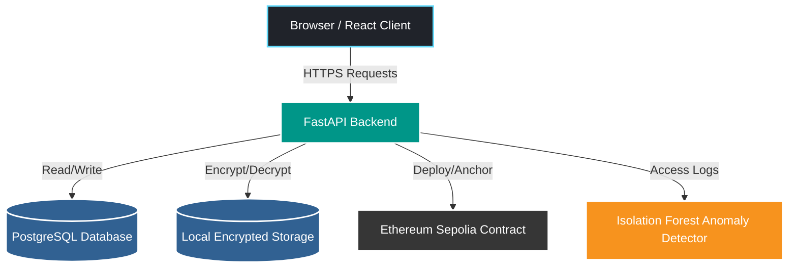

<div align="center">
  <h1>Secure Cloud File Sharing System</h1>
  <p>A highly secure, blockchain-anchored file sharing platform with ML-based anomaly detection.</p>

  
  
  
  
  
  
</div>

---

## Table of Contents
- [Overview](#overview)
- [Features](#features)
- [Architecture](#architecture)
- [Tech Stack](#tech-stack)
- [Security Design](#security-design)
- [Anomaly Detection](#anomaly-detection)
- [API Overview](#api-overview)
- [Project Structure](#project-structure)
- [Getting Started (Windows)](#getting-started-windows)
- [Blockchain Setup](#blockchain-setup)
- [Training & Evaluating the ML Model](#training--evaluating-the-ml-model)
- [Running Tests](#running-tests)
- [Screenshots](#screenshots)
- [Known Limitations](#known-limitations)
- [Roadmap](#roadmap)
- [License](#license)

---

## Overview
This repository contains a full-stack secure file sharing system designed to guarantee file integrity and protect against unauthorized access. It utilizes local encrypted storage, Ethereum testnet (Sepolia) blockchain anchoring for immutable integrity proofs, and a trained Isolation Forest machine learning model to detect anomalous user behavior in real-time.

## Features
- **User Authentication**: Secure JWT-based registration and login with Role-Based Access Control (Admin vs Regular User).
- **Secure File Storage**: AES-128-CBC + HMAC-SHA256 (Fernet) encryption for files at rest.
- **Blockchain Anchoring**: Automatic SHA-256 hash anchoring to the Ethereum Sepolia testnet upon upload.
- **Integrity Verification**: On-demand file integrity checks confirming both local decryption validity and blockchain hash matching.
- **Machine Learning Security**: Background access log analysis using an Isolation Forest to flag unusual download/delete patterns.
- **Admin Dashboard**: Specialized views for system integrity scanning and ML anomaly reports.

## Architecture



### Flows
- **Upload Flow**: The backend calculates a SHA-256 hash of the uploaded file, encrypts the file using Fernet, saves it locally, logs the access, and async-anchors the hash to the deployed Ethereum Smart Contract.
- **Verify Flow**: The system checks if the physical file exists, attempts decryption (flagging if modified), recalculates the hash, and independently compares it to both the database record and the blockchain anchor. 

## Tech Stack

| Layer | Technology |
|---|---|
| **Frontend** | React, Vite, TypeScript, Vanilla CSS |
| **Backend** | Python, FastAPI, SQLAlchemy, Alembic |
| **Database** | PostgreSQL |
| **Machine Learning** | scikit-learn (Isolation Forest), Pandas |
| **Blockchain** | Solidity, Web3.py, Hardhat (for deployment) |
| **Security** | bcrypt, pyjwt, cryptography (Fernet) |

## Security Design
- **Encryption at Rest**: Files are encrypted instantly using symmetric Fernet encryption (AES-128-CBC + HMAC-SHA256).
- **Authentication**: Stateless JSON Web Tokens (JWT) issued upon login.
- **Access Control**: Strict ownership checks on files; Admin roles can view global system health but require explicit rules to bypass ownership blocks.
- **Rate & Size Limits**: 10 MB strict file upload limit; `5/minute` rate-limiting on login endpoints to prevent brute-force.
- **Hash Anchoring & Tamper Detection**: Any modification to the encrypted ciphertexts on disk causes a verification failure (decryption error or hash mismatch), immediately rendering a "Tampered" receipt in the UI and logging a denied access event.

## Anomaly Detection
The system employs an unsupervised **Isolation Forest** model to detect unusual access patterns (e.g., rapid consecutive downloads, unusual off-hours activity, unauthorized deletion attempts). 
- **Features Used**: Daily access counts, hourly time windows, success/fail ratios, and file uniqueness per session.
- **Training**: The model is trained purely on synthetic "normal" traffic generated by helper scripts. The threshold is mathematically chosen using a dedicated validation set containing seeded anomalies.
- **Evaluation**: Tested against the previous rule-based heuristic, the model achieved a high recall and precision on the synthetic dataset (as visible via `scripts/evaluate_anomaly_model.py`).
- **Note**: The data is currently synthetic. The model *never* outright blocks a user; it passively flags rows in the database as anomalous for admin review.

## API Overview

| Endpoint | Method | Description |
|---|---|---|
| `/login` & `/register` | POST | Authentication and user creation. |
| `/files/upload` | POST | Uploads, encrypts, and blockchain-anchors a file. |
| `/files/download/{id}` | GET | Decrypts and streams the file to the owner. |
| `/files/{id}/verify` | GET | Runs local and blockchain integrity checks. |
| `/access-logs/` | GET | Returns filtered access history and anomaly flags. |
| `/admin/scan-integrity` | GET | Admin: Scans all local files vs blockchain for tampering. |
| `/admin/anomaly-report` | GET | Admin: Returns ML flagged security alerts. |

## Project Structure

```text
├── alembic/                # Database migration scripts
├── app/
│   ├── ml/                 # Machine learning models (isolation_forest.joblib) and scripts
│   ├── routes/             # FastAPI endpoint routers
│   ├── models.py           # SQLAlchemy ORM models
│   ├── schemas.py          # Pydantic validation schemas
│   ├── encryption.py       # Fernet encryption wrapper
│   └── blockchain_service.py # Web3 Ethereum wrapper
├── contracts/              # Solidity Smart Contracts (FileRegistry.sol)
├── frontend/               # React Vite Application
├── scripts/                # Database seeders, test scripts, and model evaluators
├── tests/                  # Pytest backend test suite
├── uploads/                # Encrypted file storage (gitignored)
├── .env.example            # Environment variable templates
├── docker-compose.yml      # Containerized deployment config
└── requirements.txt        # Python backend dependencies
```

## Getting Started (Windows)

### Prerequisites
- Python 3.10+
- Node.js 18+
- PostgreSQL Server running locally

### 1. Database Setup
Create a local PostgreSQL database named `secure_file_sharing`.
```sql
CREATE DATABASE secure_file_sharing;
```

### 2. Backend Setup
<details>
<summary>View Commands</summary>

```powershell
# Create and activate virtual environment
python -m venv filenv
.\filenv\Scripts\activate

# Install dependencies
pip install -r requirements.txt

# Setup Environment Variables
cp .env.example .env
# Edit .env and update DATABASE_URL, generate a JWT_SECRET_KEY, etc.

# Run Migrations
alembic upgrade head

# Generate an initial admin user
python scripts/create_admin.py

# Start Backend Server
uvicorn app.main:app --reload --host 127.0.0.1 --port 8000
```
</details>

### 3. Frontend Setup
<details>
<summary>View Commands</summary>

```powershell
cd frontend
npm ci

# Setup Environment Variables
cp .env.example .env

# Start Frontend Server
npm run dev
```
Navigate to `http://localhost:5173` in your browser.
</details>

## Blockchain Setup
By default, the blockchain service fails gracefully if disconnected. To enable:
1. Ensure you have an Ethereum Wallet (e.g. MetaMask) with Sepolia Testnet ETH.
2. Obtain an RPC URL from Infura or Alchemy for the Sepolia network.
3. Add your `PRIVATE_KEY` and `WEB3_PROVIDER_URL` to your `.env` file.
4. Run the deployment script to deploy the registry to Sepolia:
   ```powershell
   python scripts/deploy_contract.py
   ```
5. Update your `.env` with the outputted `CONTRACT_ADDRESS`.

## Training & Evaluating the ML Model
To retrain the Isolation Forest on fresh synthetic data:
```powershell
# Generate training data and train the model
python scripts/train_anomaly_model.py

# Evaluate against a validation set to see confusion matrices
python scripts/evaluate_anomaly_model.py
```

## Running Tests
Run the pytest suite to confirm routing, RBAC, and ML background job integrity:
```powershell
pytest tests/ -v
```

## Screenshots

| Login Screen | User Dashboard |
|---|---|
|  |  |
| *Clean archive-style login layout.* | *List of encrypted files with integrity badges.* |

| Verification Receipt (Intact) | Verification Receipt (Tampered) |
|---|---|
|  |  |
| *Cryptographic proof of integrity.* | *System catches unauthorized disk modifications.* |

| Security Alerts | Admin Panel |
|---|---|
|  |  |
| *ML-driven anomaly flagging.* | *Global system integrity overview for Admins.* |

## Known Limitations
- **Ethereum Testnet Limits**: Anchoring currently relies on the Sepolia Testnet through a centralized RPC (Infura). Sepolia may face deprecation, and high latency can cause upload delays.
- **Synthetic Data**: The ML model was trained on generated synthetic user patterns; it requires real-world data collection to become truly accurate.
- **Local Storage**: Files are stored in a local `./uploads` directory; horizontal scaling requires migrating this to an S3 bucket or equivalent.
- **Integrity Scan Performance**: The Admin Integrity Scan checks every file on disk synchronously; it will become slow at scale and requires pagination/background-processing.
- **Session Tokens**: JWTs are stored in `localStorage`, which is susceptible to XSS if frontend dependencies are compromised.

## Roadmap
- [ ] Migrate storage to AWS S3 / IPFS.
- [ ] Migrate JWTs to HttpOnly cookies.
- [ ] Implement robust background queue (Celery/Redis) for blockchain anchoring and integrity scanning.

## License
This project is licensed under the MIT License - see the [LICENSE](LICENSE) file for details.
